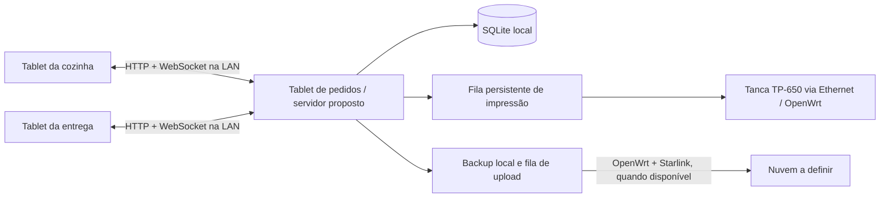

# Arquitetura proposta e migração

## 1. Decisão de implantação

**Confirmado:** um dos três tablets hospeda o servidor local. O roteador OpenWrt conecta os equipamentos; a Starlink fornece internet para funcionalidades externas.

**Proposta técnica:** Flutter nos três tablets; servidor HTTP + WebSocket em Dart embarcado no principal; SQLite acessado exclusivamente pelo servidor. Validar Android e hardware antes de fixar bibliotecas e versões.

O app de pedidos no principal também deve passar pela camada de comandos do servidor; não criar regras distintas para cliente local e clientes de rede.

## 2. Prova de viabilidade obrigatória

Antes de migrar o produto, comprovar nos tablets reais:

- Servidor acessível por outros dois dispositivos no Wi-Fi OpenWrt.
- Modelo informado SM-T815Y (Galaxy Tab S2 segundo a Samsung); verificar se os três tablets são iguais e conferir Android instalado, RAM e armazenamento. Medir uso de memória, tempo de abertura e fluidez antes de adotar dependências ou elevar Android mínimo.
- Última versão oficial identificada do SM-T815Y: Android 7.0 Nougat (API 24), conforme histórico Samsung consultado em 23/10/2026. Homologar Flutter, bibliotecas, backup/autenticação e comunicação nessa versão; confirmar a versão instalada antes de fixar compatibilidade. Não pressupor atualização oficial para Android mais recente.
- Persistência, reconexão e recuperação após reinício.
- Comportamento com troca de tela, app em segundo plano, tela apagada e políticas de bateria do fabricante.
- Estratégia Android de execução compatível com versões, tipos de serviço e forma de distribuição. Não pressupor que um serviço em primeiro plano roda indefinidamente.
- Impressão real por Ethernet na TP-650, sem computador, incluindo acentos e corte; conferir interface da unidade, configuração IP e protocolo/porta.
- Geração de backup consistente e restauração em outro dispositivo.

A falha nessa validação exige documentar o impedimento e apresentar alternativas ao usuário; não migrar silenciosamente para servidor remoto ou PC.

## 3. Organização do código

**Proposta:** separar domínio (regras e valores), aplicação (comandos/consultas), persistência (SQLite e migrações), transporte (HTTP/WebSocket), impressão, backup e interface Flutter.

Começar com um servidor e um banco, sem dependência inicial de Redis ou serviços distribuídos. Escolher bibliotecas após a prova de viabilidade e registrar compatibilidade/licenças/versões no lockfile.

## 4. Contrato de sincronização

- Comandos têm `command_id`, identificação do dispositivo e parâmetros validados.
- Criar/alterar pedido persiste atomicamente dados, resultado do comando e revisão/evento correspondente.
- Repetir `command_id` com mesmo conteúdo devolve o resultado anterior; com conteúdo diferente gera erro.
- Entidades têm IDs estáveis e revisão; mudanças concorrentes usam revisão esperada ou transação equivalente.
- Notificações só representam estado confirmado. Evento inclui ID, revisão, entidade e tipo, sem depender da posição visual.
- Snapshot das filas inclui revisão consistente. Sincronizar snapshot e stream com cursor/replay ou buffer, evitando a janela em que um evento se perde durante a consulta.
- Clientes ignoram duplicatas, detectam lacunas e fazem nova consulta quando necessário.
- Na conexão, reconexão, retorno ao primeiro plano e detecção de estado atrasado, reconciliar com o servidor.
- Falha de publicação após commit é recuperável por replay ou nova leitura; pedido persistido não pode ficar invisível para sempre.
- HTTP e eventos usam o mesmo formato de pedido; sem campos divergentes como `id` em um caminho e `pedido_id` em outro sem adaptação explícita.
- A interface deriva a lista do estado por ID; animações são efeitos visuais e não alteram o domínio.

Se for escolhido WebSocket padrão, o cliente atual Socket.IO precisará ser adaptado: os protocolos não são intercambiáveis.

## 5. Persistência

- Arquivo SQLite no armazenamento privado do servidor; nunca compartilhar o arquivo pela rede.
- Chaves estrangeiras, transações, migrações versionadas e estratégia de escrita concorrente testada.
- Valores monetários em centavos; quantidades e preços validados no servidor.
- Produção/entrega parciais: contadores acumulados por item e histórico, com os limites de `REQUISITOS.md`; incrementos atômicos, idempotentes e proteção contra consumo concorrente do mesmo saldo. Status de pedido é derivado das quantidades, sem concluir todo o item por uma ação parcial.
- Senha segue 1–99 e volta a 1 após 99; reinicia em 1 à meia-noite em `America/Sao_Paulo`. Não há operação após 23h59. Guardar sequência por data operacional e alocar atomicamente; a primeira criação do novo dia reinicia mesmo se o servidor estava desligado à meia-noite. Reinício do app no mesmo dia não reinicia a sequência.
- Senha é independente do ID interno; o histórico pode repetir a mesma senha na mesma data após um ciclo. Não aplicar unicidade `(senha, data)` a todos os pedidos nem implementar seleção de senhas livres. O responsável descarta esgotamento de 99 senhas ativas neste cenário.
- Entidades propostas: produtos, pedidos, itens, personalizações, jornada, sequência de senha, comandos processados, eventos/revisões, trabalhos de impressão, registros de backup e dispositivos autorizados.
- Guardar no item vendido o retrato de nome/preço/personalização; alteração do catálogo não modifica vendas anteriores.
- Datas de eventos em UTC; apresentação e jornada em `America/Sao_Paulo`, sem ocultar pendentes pela virada do dia.
- Versão de protocolo e schema permitem detectar APK incompatível antes de aceitar comandos.

## 6. Rede e acesso

- Proposta: reservas DHCP no OpenWrt para servidor e impressora de rede, se houver; registrar IP, MAC e porta em inventário operacional sem credenciais.
- Rede dos tablets deve permitir comunicação local. Rede de visitantes, se existir, deve ficar isolada da operação.
- Não publicar banco ou API por redirecionamento de portas na internet.
- Pareamento/credenciais por dispositivo e permissões de operação; não confiar apenas no IP.
- Definir transporte seguro e provisionamento de certificados antes da produção, inclusive para o upload; não desativar validação TLS como solução definitiva.
- A nuvem recebe backups; não participa de cada pedido.

## 7. Impressão e backup

Impressão é um trabalho persistido separado da transação de pedido. Um executor no principal serializa o acesso à impressora por Ethernet no OpenWrt, sem computador. A interface Ethernet é documentada pelo fabricante; validar unidade, protocolo e porta reais. USB no computador é somente o cenário legado. Não portar `win32print` para Android.

Envio não equivale necessariamente à confirmação física do papel. Após falha ambígua, permitir conferência e reimpressão explícita; não prometer impressão exatamente uma vez.

Backup usa API apropriada do SQLite ou snapshot consistente como `VACUUM INTO`, nunca cópia ingênua do arquivo aberto. Incluir manifesto e integridade; criptografia e chave recuperável; upload com retomada/tentativas e resultado verificável.

WorkManager é uma opção Android para tentativas adiáveis, sem promessa de horário exato. Gatilho no fechamento e verificação ao abrir complementam o agendamento. Provedor e autenticação de produção devem ser decididos antes da integração real.

Priorizar armazenamento gratuito; candidato inicial Google Drive. Medir backup e cota disponível, contabilizar retenção e não criar dependência de plano pago ou faturamento automático. Monitorar espaço e preservar a última cópia válida durante rotação. A conta e a integração ainda não foram autorizadas/configuradas.

## 8. Recuperação e atualização

- Se o principal falhar, os demais informam indisponibilidade; cache não vira autoridade automaticamente.
- Troca de principal é procedimento manual e explícito: interromper o anterior, restaurar, validar, selecionar o novo endereço e reconectar.
- Impedir dois servidores ativos independentes para a mesma jornada; não implementar eleição automática nesta primeira versão.
- Restauração deve renovar pareamentos quando necessário, validar schema, reconstruir filas e suspender trabalhos antigos de impressão até revisão.
- Depois de restaurar, verificar pedidos posteriores à cópia por procedimento operacional e evitar colisão/reutilização indevida de senhas.
- Atualização: backup verificável, compatibilidade, migração testada, validação e plano de retorno. APK antigo não deve abrir banco migrado incompatível.

## 9. Migração do legado

1. Inventariar regras e defeitos; criar dados sintéticos de referência.
2. Implementar e validar o núcleo Dart/SQLite com clientes de teste.
3. Adaptar Flutter aos contratos e prototipar produção por cartões.
4. Implementar impressão, backup e recuperação validados em equipamento real.
5. Criar importador explícito de PostgreSQL para SQLite, somente se for necessário preservar histórico/catálogo; conciliar contagens e totais.
6. Ensaiar um turno com dados de teste, corte de internet e reconexões.
7. Fazer transição controlada entre jornadas, preservando o legado e uma cópia de recuperação.

Não executar versões antiga e nova aceitando pedidos reais simultaneamente sem um plano específico de consistência.

## Referências técnicas consultadas

- [Dart: HTTP e sockets em apps móveis](https://api.dart.dev/dart-io/)
- [SQLite: aplicações adequadas](https://www.sqlite.org/whentouse.html)
- [SQLite: backup consistente](https://sqlite.org/backup.html)
- [Android: limites de serviços em primeiro plano](https://developer.android.com/develop/background-work/services/fgs/timeout)
- [Android: trabalho periódico e restrições](https://developer.android.com/develop/background-work/background-tasks/persistent/getting-started/define-work)
- [Google Drive: armazenamento específico do aplicativo](https://developers.google.com/workspace/drive/api/guides/appdata)
- [Google: cota gratuita compartilhada de até 15 GB](https://support.google.com/googleone/answer/9004014?hl=en)
- [Tanca TP-650: interfaces na ficha técnica](https://tanca.com.br/assets/conteudo/uploads/tp650v060421compressed6526ffe300879.pdf)
- [Samsung: identificação Galaxy Tab S2 SM-T815Y](https://doc.samsungmobile.com/SM-T815Y/016502210109/eng.html)
- [Samsung: atualização SM-T815Y em Android 7.0](https://doc.samsungmobile.com/SM-T815Y/016568210115/eng.html)

Verificar novamente a documentação das plataformas no momento de implementar; estas referências não substituem testes nos dispositivos.
